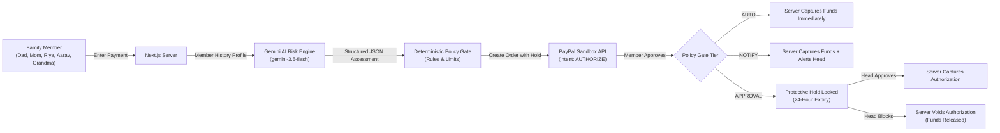

# Guardian Pay: Autonomous AI Family Payment Guardian

> **PayPal AI Hackathon 2026 Entry ("Build What's Next with PayPal and AI")**  
> *Prototype. PayPal sandbox only, fake money. Inspired by how Indian families pay with UPI but not connected to UPI.*

---

## 1. What is Guardian Pay?
In a family where multiple members pay several times a day, the head of the family cannot monitor individual transactions, making younger members and elders prime targets for scams. Existing financial fraud protections usually alert victims *after* the money has already left the account.

**Guardian Pay** is an autonomous AI agent that watches a family's payment requests and acts **before** money moves:
- **Small, routine payments** process automatically with zero friction (Tier 1: `AUTO`).
- **Moderate payments** go through while sending a transparent ping to the family head (Tier 2: `NOTIFY`).
- **High-value or suspicious transactions** (e.g. urgent KYC demands, fake tech support, unknown recipients) are placed under a protective **PayPal authorization hold** until the head of the family reviews the AI risk reasons and decides to **Approve (Capture)** or **Block (Void)** (Tier 3: `APPROVAL`).

---

## 2. Architecture & How It Works



### The Three Tiers (Configured Per Member)
| Member | Role | Auto Limit | Notify Limit | Approval Required Above |
| :--- | :--- | :--- | :--- | :--- |
| **Dad** | Head | No limit | No limit | Never held (Logged) |
| **Mom** | Adult | $25.00 | $100.00 | $100.00 |
| **Riya** | Teen | $10.00 | $40.00 | $40.00 |
| **Aarav** | Child | $5.00 | $20.00 | $20.00 |
| **Grandma** | Elder | $10.00 | $30.00 | $30.00 |

---

## 3. How PayPal & AI Are Used

### PayPal REST API Integration
- **Two-Phase Authorization Holds:** Every order is created with `intent: "AUTHORIZE"` (`POST /v2/checkout/orders`). This reserves funds without taking them.
- **Capture on Approval:** For safe payments or when Dad clicks "Approve", the server calls `POST /v2/payments/authorizations/{id}/capture` with `final_capture: true`.
- **Zero-Fee Cancellation via Void:** If Dad blocks a payment or the 24-hour deadline expires, the server calls `POST /v2/payments/authorizations/{id}/void`. The hold disappears without refund fees.
- **Idempotency & Tracking:** Every call uses `PayPal-Request-Id` idempotency headers and logs `PayPal-Debug-Id` on error.
- **Webhooks:** Listens to `PAYMENT.AUTHORIZATION.CREATED`, `PAYMENT.AUTHORIZATION.VOIDED`, `PAYMENT.CAPTURE.COMPLETED`, and `PAYMENT.CAPTURE.DENIED` with cryptographic signature verification via `/v1/notifications/verify-webhook-signature`.
- **Implementation:** Direct REST API calls via `fetch` with token caching and automatic retry on 401 (token expiry). Built referencing official PayPal developer documentation for correctness.

### Google Gemini AI Engine
- **Model:** `gemini-3.5-flash` with strict JSON mode.
- **Role:** Analyzes the payment amount, historical averages, recent 24-hour volume, and the member's stated reason.
- **Security & Prompt Injection Resilience:** The member's stated reason is strictly treated as untrusted data. The deterministic Policy Gate enforces limits in code: **the AI can only escalate a payment, never downgrade it**.
- **Weekly Executive Synthesis:** Summarizes 7-day spending patterns and flagged security events for the head of family in 4–6 clear sentences.

---

## 4. Running the App Locally

### Quick Start (Desktop Folder Launcher)
On macOS, simply double-click the **`open-app.command`** file inside the `family-guardian` folder on your Desktop! It will launch the local server and open your browser automatically.

### Manual Terminal Setup
```bash
# 1. Clone repository
git clone https://github.com/your-username/guardian-pay.git
cd guardian-pay

# 2. Install dependencies
npm install

# 3. Configure environment variables
cp .env.example .env
# Edit .env with your PayPal Sandbox credentials and Gemini API key

# 4. Run tests (Verifies 17 Policy Gate test cases)
npm test

# 5. Start development server
npm run dev
# Open http://localhost:3000 in your browser
```

---

## 5. The Four Demo Scenarios

Visit `/demo` in the app for one-click repeatable execution of the four core judging scenarios:

1. **Riya, $4.00, "Snacks and juice" $\rightarrow$ AUTO**  
   Amount is within Riya's $10 auto limit. Evaluated as low risk, captures immediately without notification.
2. **Mom, $35.00, "Weekly groceries" $\rightarrow$ NOTIFY**  
   Exceeds Mom's $25 auto limit but below $100. Captures immediately and pings Dad with a notification.
3. **Grandma, $5.00, "KYC Verify Desk" $\rightarrow$ APPROVAL (AI Escalation)**  
   *The Scam Scenario:* $5 is below Grandma's $10 auto limit. However, the AI identifies urgent pressure and bank KYC impersonation signals (`#urgency`, `#impersonation`, `#fake_verification`), escalating it to Tier 3: APPROVAL. The money is placed on hold until Dad reviews and blocks it.
4. **Riya, $90.00, "School trip fee" $\rightarrow$ APPROVAL**  
   Legitimate high-value payment exceeding Riya's $40 notify limit. Held until Dad verifies and approves it.

---

## 6. Honest Limitations & Disclosures

- **Prototype & Sandbox Only:** Built exclusively for the PayPal Sandbox environment using simulated funds. No real money or bank accounts are connected.
- **Simulated Recipients:** In the PayPal Sandbox, all transactions transfer into the developer's sandbox merchant account. The "recipient" is an organizational label stored in the local SQLite database.
- **Inspiration from UPI Circle:** India's UPI Circle recently introduced family payment delegation. Guardian Pay was inspired by this concept, but is **not** connected to UPI or the NPCI network. Our contribution is proactive AI contextual risk assessment coupled with PayPal two-phase authorization holds.
- **Human-in-the-Loop:** AI risk scoring is probabilistic and imperfect. That is why the Policy Gate enforces human review for all escalated payments.
- **Accessibility:** Designed with semantic HTML, 18px+ readable typography, and high-contrast color palettes, but not formally WCAG-certified.
- **Geographic Availability:** PayPal features and sandbox availability vary by country.

---

## 7. License
Distributed under the **MIT License**. See `LICENSE` for details.

