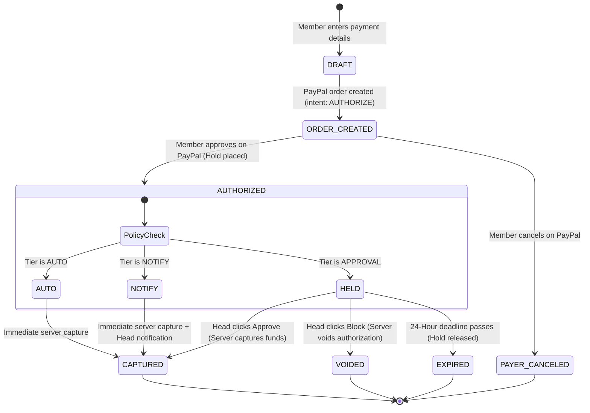
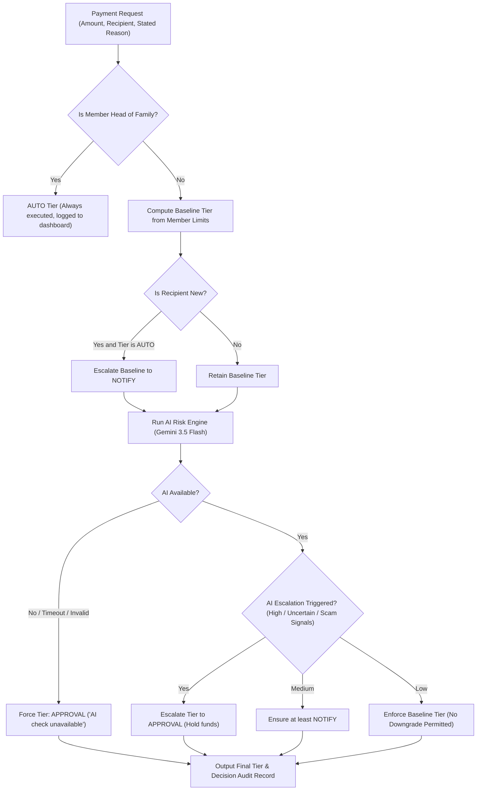

# Guardian Pay - Architecture & Technical Design

## 1. Executive Summary
**Guardian Pay** is an autonomous AI financial guardian designed for families. Built for the PayPal AI Hackathon 2026, it introduces an active preventive layer before money leaves family accounts. Rather than alerting family heads after fraud or impulsive spending has occurred, Guardian Pay integrates PayPal authorization holds (`intent: AUTHORIZE`) with a strict deterministic Policy Gate and Google Gemini AI risk intelligence.

---

## 2. Payment State Machine

---

## 3. The Policy Gate Hierarchy (Determinism Over AI)

A core security principle of Guardian Pay is that **AI can only escalate risk, never downgrade it**. Even if a malicious prompt injection attempts to trick the AI into declaring a transaction "low risk", the deterministic Policy Gate strictly enforces member limit boundaries.

---

## 4. Default Family Member Limit Matrix

| Family Member | Role | Auto-Approve Limit | Notify Limit | Approval Required Above |
| :--- | :--- | :--- | :--- | :--- |
| **Dad** | Head of Family | No limit | No limit | Never held (Logged) |
| **Mom** | Adult | Up to $25.00 | Up to $100.00 | Above $100.00 |
| **Riya** | Teen | Up to $10.00 | Up to $40.00 | Above $40.00 |
| **Aarav** | Child | Up to $5.00 | Up to $20.00 | Above $20.00 |
| **Grandma** | Elder | Up to $10.00 | Up to $30.00 | Above $30.00 |

### Key Policy Rules:
1. **Rule 1 (Amount Minimum):** The transaction amount dictates the minimum tier based on the member's configured limits.
2. **Rule 2 (AI Escalation Only):** If the AI detects `escalate: true`, `risk_level: high`, or `risk_level: uncertain`, the tier is forced to `APPROVAL`. Medium risk forces at least `NOTIFY`.
3. **Rule 3 (No Downgrade):** The AI can never lower an over-limit payment below `APPROVAL`.
4. **Rule 4 (AI Failure Safety):** If the AI times out or throws an error, the system defaults to safe mode: `APPROVAL` tier with reason `"AI check unavailable"`.
5. **Rule 5 (New Recipient Safeguard):** For non-head members, a new recipient moves an `AUTO` tier payment up to `NOTIFY`.
6. **Rule 6 (Dual Head Control):** Only an explicit head action (or the 24-hour timeout) can release held funds.
7. **Rule 7 (Audit Immutability):** Every evaluation input, AI output, and gate reason is written to the immutable `audit_log` table.

---

## 5. Technology Stack Summary
- **Frontend & Backend:** Next.js (App Router), React 19, TypeScript.
- **Styling:** Semantic HTML5, accessible plain CSS (18px+ typography, high contrast, WCAG compliant contrast ratios).
- **Database:** SQLite (`better-sqlite3`) with WAL journal mode.
- **Enterprise Data Grid:** AG Grid Community v36 (`@ag-grid-community/all-modules`).
- **AI Intelligence:** Google Gemini API (`gemini-3.5-flash`) via structured JSON schema enforcement with Zod.
- **Payments:** PayPal REST APIs (`/v1/oauth2/token`, `/v2/checkout/orders`, `/v2/payments/authorizations/{id}/capture`, `/v2/payments/authorizations/{id}/void`, `/v1/notifications/verify-webhook-signature`).

